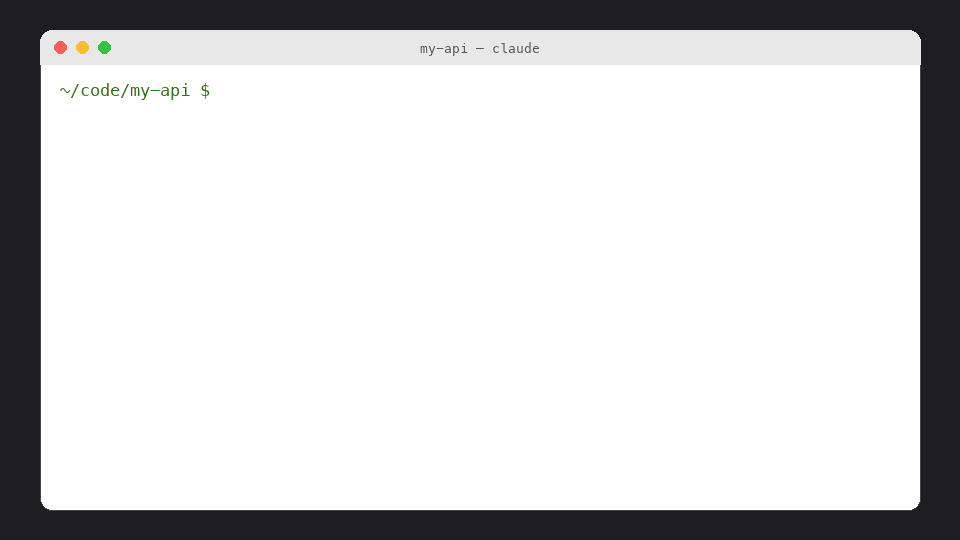

# claude-color

Give every Claude Code session its own terminal background color, chosen by project.



`cd` into a project and run `claude` as usual. The window tints to that project's color while Claude runs and goes back to normal when it exits. The same project always gets the same color, so you can tell windows apart at a glance. Run `/claude-color` inside Claude to pick a different one.

## Install

**As a Claude Code plugin** (named `terminal-tint`):

```
/plugin marketplace add adamzaidi/claude-color
/plugin install terminal-tint@terminal-tint
```

Then run `/claude-color setup` once. That adds the shell part, which tints the window at launch and puts your colors back when Claude exits.

**Or from a clone:**

```sh
git clone https://github.com/adamzaidi/claude-color.git ~/claude-color
~/claude-color/install.sh
```

Either way, open a new terminal window afterwards. Requires zsh (the macOS default).

## Choosing colors

Inside Claude Code, in the window you're working in:

```
/claude-color                 open the picker (your current color is listed first)
/claude-color plum            use a palette color
/claude-color #2a2240         use any hex
/claude-color something warm  describe it and Claude picks a color
/claude-color next            cycle to the next palette color
/claude-color reset           back to the automatic color
```

The window changes right away, and the choice is saved for that project. Bold text and the cursor get a light shade of the same hue (pale mint on forest, pale blue on navy), so headings stay readable. Claude also tells you the matching built-in `/color` command, so the prompt bar can match the window.

| Group | Colors |
| --- | --- |
| Blues & purples | navy, slate, indigo, plum |
| Greens | forest, pine, olive, teal |
| Warm | walnut, cocoa, wine, oxblood |

The same works from a regular shell:

```sh
claude-color              # this project's color + matching /color
claude-color list         # palette with swatches
claude-color teal         # set it (saved + applied now)
claude-color preview '#203040'   # try it without saving
claude-color next | reset | rules
```

## How the color is picked

1. The project is the git root of the current directory, or the directory itself outside a repo.
2. If a rule in `~/.config/claude-color/overrides` matches, its color is used.
3. Otherwise the path is hashed into the 12-color palette.

## Overrides

`~/.config/claude-color/overrides`:

```
# <text in the project path>  <#hex>
/Users/me/code/my-api   #3b1f1f
notes                   #1a3328
```

An absolute path matches that project exactly. Any other text matches every project whose path contains it. The first match wins, and `/claude-color <color>` writes exact-path rules at the top.

## Settings

Put these in `~/.zshrc` before the `source` line:

| Variable | Effect |
| --- | --- |
| `CLAUDE_COLOR_DISABLE=1` | Turn it off without uninstalling |
| `CLAUDE_COLOR_PALETTE=(name=#hex ...)` | Use your own colors |
| `CLAUDE_COLOR_GROUPS=("Label:name name" ...)` | Groups shown in the picker (max 4 colors each) |
| `CLAUDE_COLOR_TEXT="#e6e6e6"` | Text color while tinted |
| `CLAUDE_COLOR_ACCENT="#hex"` | Fixed bold and cursor color (default: a light shade of each background's hue) |
| `CLAUDE_COLOR_CONFIG=path` | Use a different overrides file |

## Terminal support

- **Terminal.app**: uses AppleScript on the tab that owns your shell, and saves and restores your exact colors (background, text, bold and cursor). The first run asks to let Terminal control Terminal. Click Allow.
- **iTerm2, Ghostty, kitty, WezTerm, VS Code**: uses standard OSC 10/11 escape codes and resets to your profile's colors on exit.

## Uninstall

Remove the `claude-color` lines from `~/.zshrc`, delete `~/.local/share/claude-color`, and either `/plugin uninstall terminal-tint` or remove `~/.claude/skills/claude-color`.

## License

MIT
